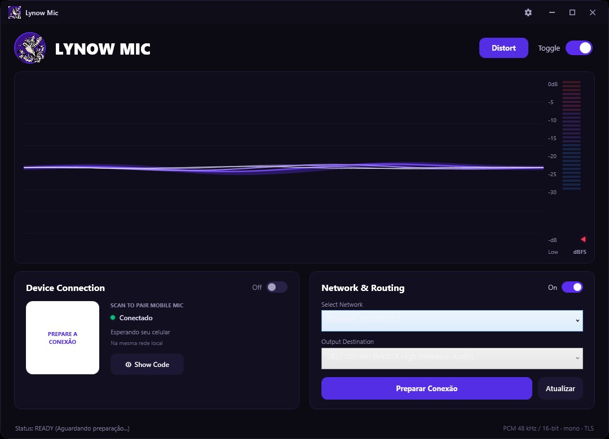
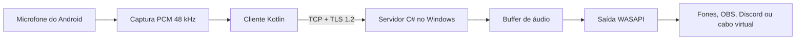
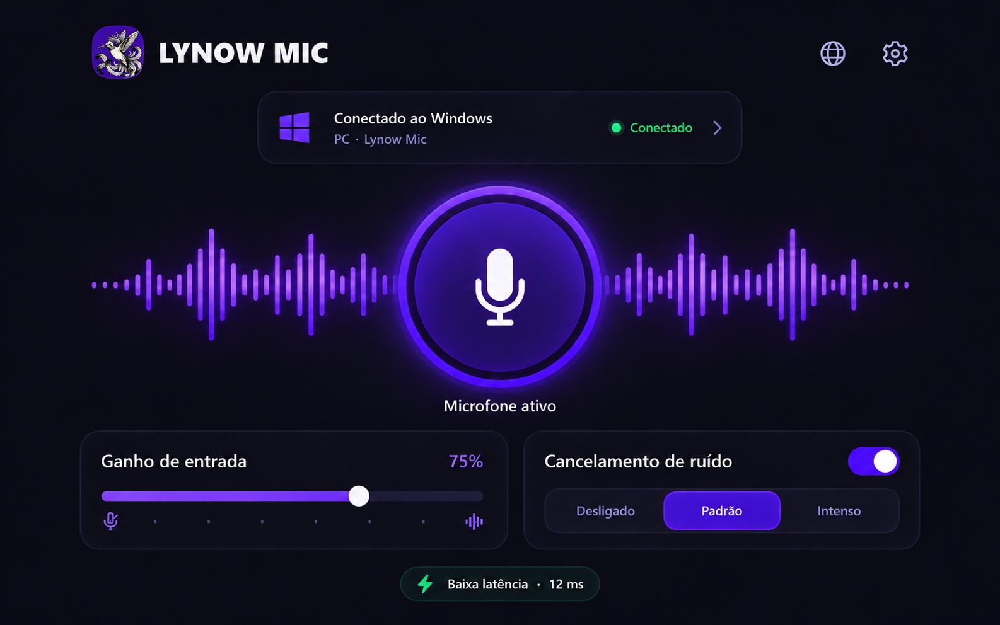
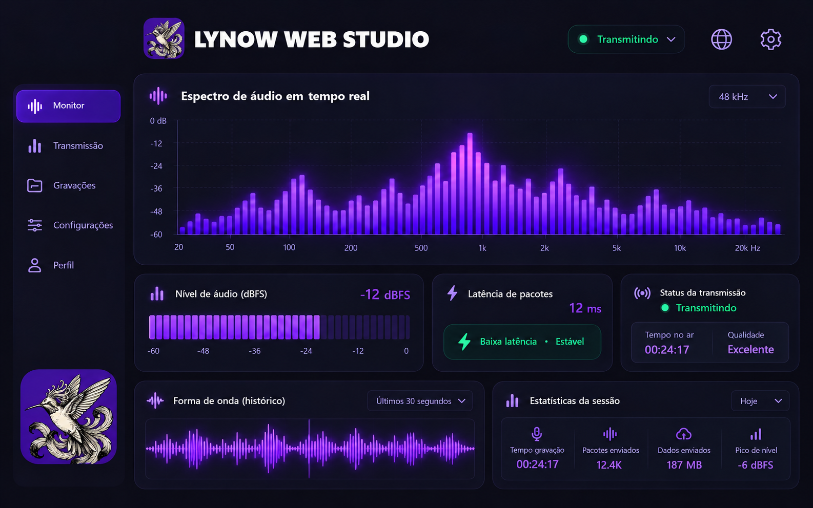

<p align="center">
  
</p>

<p align="center">
  Transforme o microfone do seu celular Android em uma fonte de áudio para o Windows pela rede local.
</p>

<p align="center">
  <a href="https://github.com/arthurlynow098/LynowMic/releases"></a>
  
  
</p>

> [!IMPORTANT]
> O executável para Windows, o APK para Android e o arquivo de verificação SHA-256 estão disponíveis em **[Releases](https://github.com/arthurlynow098/LynowMic/releases)**. Os binários não ficam dentro do histórico do repositório.

## Sobre o projeto

O Lynow Mic nasceu de uma necessidade prática: aproveitar o microfone de um celular no computador sem depender de cabo. O Android captura a voz e envia o áudio diretamente pela rede local; o aplicativo Windows recebe o fluxo e o encaminha para a saída escolhida pelo usuário.

O pareamento acontece por QR Code e cria uma sessão temporária protegida por TLS. Não há conta, nuvem, anúncios ou telemetria. Depois da instalação, a comunicação acontece entre o celular e o computador na mesma rede.



## Principais recursos

| Recurso | Como funciona |
|---|---|
| Pareamento por QR Code | O Windows gera os dados temporários da sessão e o Android faz a leitura pela câmera. |
| Áudio pela rede local | Transmissão PCM mono, 48 kHz, 16 bits, em quadros de 20 ms. |
| Conexão protegida | TCP com TLS 1.2, pinagem do certificado da sessão e token aleatório de 256 bits. |
| Escolha da saída | O áudio recebido é reproduzido pelo dispositivo WASAPI selecionado no Windows. |
| Controle durante o uso | Ganho, silenciar, nível de áudio, duração da conexão e estado do buffer. |
| Continuidade no Android | Serviço em primeiro plano, notificação e tentativas limitadas de reconexão. |
| Privacidade local | O áudio não é enviado para servidores externos e não é gravado pelo projeto. |

## Tecnologias

<p>
  
  
  
  
  
  
  
  
</p>

### Windows

- **C# e .NET 8** para a aplicação desktop;
- **WPF/XAML** para a interface nativa;
- **NAudio 2.2.1** para reprodução e roteamento via WASAPI;
- **QRCoder 1.6.0** para geração do código de pareamento;
- publicação `win-x64` autocontida, sem exigir instalação prévia do .NET.

### Android

- **Kotlin 2.0.21** e **Java 17**;
- Android nativo com compatibilidade a partir da **API 26 (Android 8)**;
- **AndroidX** para ciclo de vida e componentes da aplicação;
- **ZXing Android Embedded 4.3.0** para leitura do QR Code;
- **Gradle 8.9** e Android Gradle Plugin 8.7.3;
- testes unitários com **JUnit 4**.

### Rede e áudio

- TCP sobre **TLS 1.2**;
- protocolo próprio documentado e versionado;
- áudio **PCM16 little-endian**, mono, 48 kHz;
- frames de 1.920 bytes a cada 20 ms;
- certificado e credencial renovados a cada sessão;
- buffer limitado no Windows para evitar acúmulo contínuo de atraso.

## Arquitetura



O QR Code é o canal inicial de confiança. Ele leva o endereço local, a porta, a impressão digital do certificado e um token temporário. O Android valida o certificado antes de transmitir, e o Windows aceita apenas o cliente que apresenta os dados esperados para aquela sessão.

## Experiência no Android

O aplicativo móvel foi pensado para deixar a conexão clara: identificar o computador, controlar o ganho, silenciar o microfone e acompanhar o estado da transmissão sem atravessar várias telas.



## Monitoramento e identidade visual

O painel abaixo representa a direção visual estudada para uma área de monitoramento mais ampla, com espectro, nível em dBFS, latência e dados da sessão. Ele faz parte da apresentação visual do produto e não deve ser interpretado como uma função já finalizada nesta alpha.



## Fluxo de uso

1. Baixe o Windows e o Android em **[Releases](https://github.com/arthurlynow098/LynowMic/releases)**.
2. Execute o Lynow Mic no computador e instale o APK no celular.
3. Mantenha os dois dispositivos na mesma rede local.
4. Escolha a interface de rede e a saída de áudio no Windows.
5. Clique em **Preparar conexão** e leia o QR Code pelo Android.
6. Autorize câmera e microfone quando o sistema solicitar.
7. Para usar a voz no OBS, Discord ou em jogos, selecione uma saída de áudio virtual instalada separadamente.

Para uma verificação rápida, é possível escolher os próprios fones como saída. Nesse modo você escuta o áudio recebido, mas o Windows não o apresenta como um novo dispositivo de microfone.

## Estrutura do repositório

```text
LynowMic-0.1-alpha/
├── Codigo-fonte/
│   ├── android/                 Aplicativo móvel em Kotlin
│   ├── windows/                 Aplicativo desktop em C# e WPF
│   ├── tests/ProtocolTests/     Testes do protocolo e áudio
│   ├── docs/                    Protocolo e documentação de testes
│   └── scripts/                 Compilação e assinatura
├── images/                      Capturas e material visual
└── LEIA-ME-PRIMEIRO.html        Apresentação e guia rápido
```

## Executando o código

### Windows

Requisitos: Windows 10 ou mais recente e SDK .NET 8.

```powershell
dotnet build LynowMic-0.1-alpha/Codigo-fonte/windows/LynowMic.Windows/LynowMic.Windows.csproj -c Release
dotnet run --project LynowMic-0.1-alpha/Codigo-fonte/tests/ProtocolTests -c Release
```

### Android

Requisitos: JDK 17, Android SDK 35 e Android Studio ou Gradle pela linha de comando.

```powershell
cd LynowMic-0.1-alpha/Codigo-fonte/android
./gradlew.bat :app:assembleDebug :app:testDebugUnitTest
```

## Decisões técnicas

- **Aplicações nativas:** a interface e o acesso ao áudio usam as APIs próprias de cada plataforma.
- **Rede local:** reduz dependências externas e mantém o áudio dentro da infraestrutura do usuário.
- **PCM sem compressão:** simplifica o protocolo e evita perdas introduzidas por codec nesta etapa do projeto.
- **TLS com pinagem:** protege a sessão mesmo sem depender de uma autoridade certificadora pública.
- **Sessões descartáveis:** reiniciar a conexão invalida o QR Code e as credenciais anteriores.
- **Protocolo documentado:** formato do handshake, frames, timeouts e limites estão descritos em [`docs/PROTOCOL.md`](LynowMic-0.1-alpha/Codigo-fonte/docs/PROTOCOL.md).

## Estado atual

Esta é a versão **0.1.0 alpha**. O núcleo Android → rede local → Windows está implementado, junto dos controles e das validações do protocolo. O projeto ainda não inclui driver virtual próprio, transmissão pela internet, USB, Bluetooth, instalador Windows, atualização automática ou publicação em loja.

O executável Windows ainda não possui assinatura Authenticode comercial, e o APK disponibilizado é uma compilação de teste. Em máquinas que ainda não reconhecem o editor, o Windows pode exibir um aviso de reputação. O hash publicado na Release permite conferir se o arquivo baixado é o mesmo produzido pelo projeto.

## Documentação

- [Guia completo do projeto](LynowMic-0.1-alpha/Codigo-fonte/README.md)
- [Especificação do protocolo](LynowMic-0.1-alpha/Codigo-fonte/docs/PROTOCOL.md)
- [Roteiro de teste em dispositivos](LynowMic-0.1-alpha/Codigo-fonte/docs/TESTE-NOS-DISPOSITIVOS.md)
- [Registro de verificações](LynowMic-0.1-alpha/Codigo-fonte/docs/VERIFICACAO.md)
- [Avisos de terceiros](LynowMic-0.1-alpha/Codigo-fonte/THIRD-PARTY-NOTICES.md)

## Licença

Distribuído sob a [licença MIT](LynowMic-0.1-alpha/Codigo-fonte/LICENSE). As licenças das bibliotecas utilizadas estão reunidas no diretório [`licenses`](LynowMic-0.1-alpha/Codigo-fonte/licenses).
